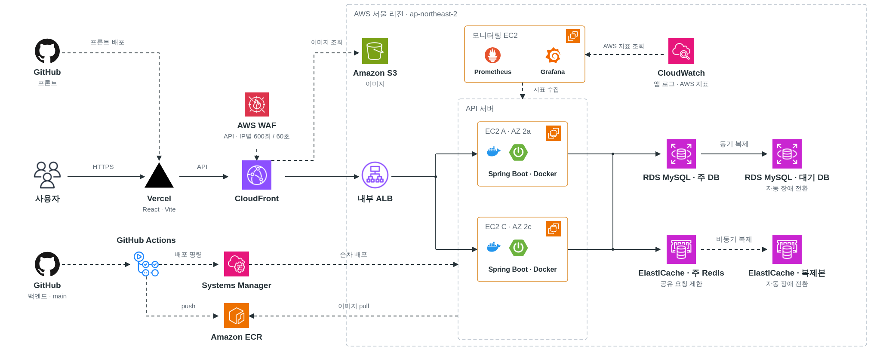

# 운영 아키텍처

- 사용자 요청: Vercel → CloudFront·WAF → 내부 ALB → API A/C
- 데이터 저장: RDS 주 DB·동기 대기 DB, Redis 주 노드·비동기 복제본
- 배포: GitHub Actions에서 ECR 이미지 게시와 SSM 배포 명령을 분리하고, API 서버가 이미지를 내려받아 순차 교체
- 모니터링: Prometheus·Grafana와 CloudWatch로 앱·서버·AWS 지표 조회

[설계 선택과 실제 테스트 결과](../../README.md)
